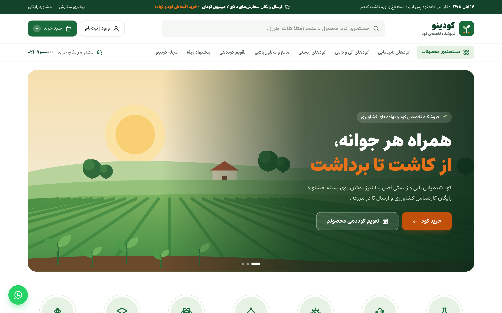
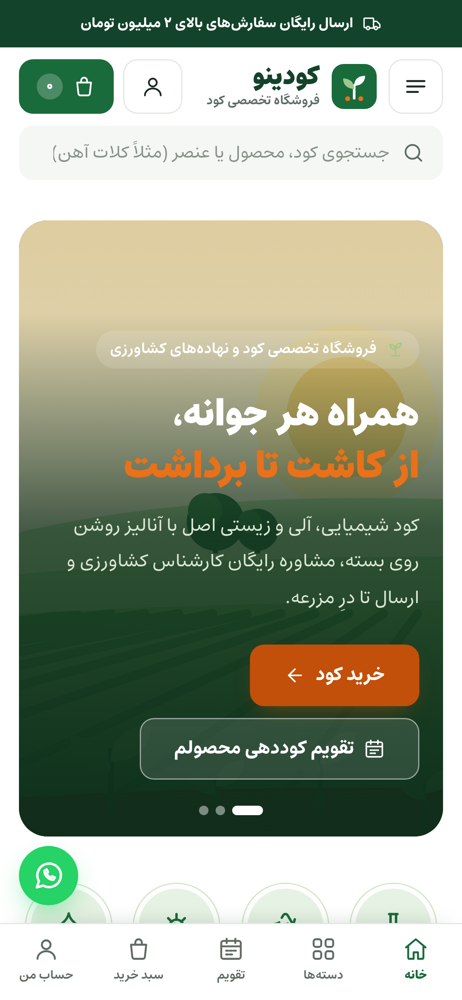

# کودینو (Kudino)

قالب وردپرس فروشگاه تخصصی کود.



| موبایل | تقویم کوددهی در موبایل |
| --- | --- |
|  |  |

اسکرین‌شات کامل صفحه اصلی: [`screenshots/home-desktop.png`](screenshots/home-desktop.png)

## زبان طراحی: «دشت»

این طراحی بر اساس قراردادهای فروشگاه‌های کشاورزی ایرانی (مثل دشت سبز و کودیاب) ساخته شده، با امکاناتی که فقط کودینو دارد:

- **رنگ:** سبز مزرعه برای اعتماد و دکمه‌های اصلی، نارنجی برداشت برای پیشنهادها و دعوت به خرید، قرمز فقط برای درصد تخفیف، و پس‌زمینه‌های سبز کم‌رنگ. رنگ‌های N، P و K فقط برای نمایش داده استفاده می‌شوند.
- **فونت:** استعداد (Estedad)، فونت فارسی آزاد. آنالیز کود با IBM Plex Mono نوشته می‌شود. هر دو داخل قالب میزبانی می‌شوند.
- **چینش:** نوار پیام و خرید اقساطی، جستجوی بزرگ، منوی دسته‌بندی، اسلایدر با پیشنهاد و شمارش معکوس، دسته‌بندی‌های دایره‌ای، پیشنهاد ویژه هفته، بنرهای دوتکه، اسلایدر محصولات با فیلتر، برندها، مشاوره واتساپ، نظر مشتری‌ها، مجله، ردیف اطمینان، کارت‌های تماس و نماد اعتماد در فوتر.
- **امکانات خاص کودینو:** تقویم کوددهی ۱۲ ماهه شمسی برای هر محصول، و تشخیص کمبود عناصر از روی علامت برگ.
- **عکس‌ها:** عکس اسلاید اول و بنرها از «سفارشی‌سازی ← تنظیمات کودینو» آپلود می‌شوند و عکس محصولات از ووکامرس می‌آیند. تا وقتی عکسی آپلود نشده، تصویرسازی برداری نمایش داده می‌شود.

## ساختار

```
kudino/                  قالب وردپرس
  assets/css/tokens.css  توکن‌ها (منبع اصلی)
  assets/css/main.css    کامپوننت‌ها و چیدمان
  assets/css/woocommerce.css
  assets/js/main.js      بدون وابستگی؛ همه‌چیز بدون JS هم کار می‌کند
  assets/fonts/          Estedad, IBM Plex Mono (OFL)
  inc/                   helpers، داده‌ها، customizer، ووکامرس
  front-page.php         صفحه اصلی
  woocommerce/           قالب آیتم محصول در قفسه
design-system/
  build.py               ساخت فایل‌های سیستم طراحی از روی قالب
  project/               فایل‌های منتشرشده در Claude Design
screenshots/
```

## نصب

۱. پوشه `kudino` را در `wp-content/themes/` کپی و از «نمایش ← پوسته‌ها» فعالش کنید.
۲. (اختیاری) ووکامرس را نصب کنید. دسته‌های محصول با این نامک‌ها به فهرست قفسه‌ها وصل می‌شوند: `chemical`، `organic`، `bio`، `liquid`، `micro`، `houseplant`.
۳. در صفحه ویرایش هر محصول، فیلد «آنالیز NPK» (مثلاً `20-20-20`) و «وزن بسته» را پر کنید.
۴. تلفن، واتساپ، آدرس، متن هیرو، مدت پیشنهاد ویژه و عکس‌ها را از «سفارشی‌سازی ← تنظیمات کودینو» تنظیم کنید.

تا وقتی محصول یا نوشته‌ای ثبت نشده، قالب محتوای نمونه نشان می‌دهد. همه داده‌ها (دسته‌ها، عناصر، تقویم محصولات، محصول هیرو) از طریق فیلترها قابل تغییرند: `kudino_categories`، `kudino_elements`، `kudino_crop_guides`، `kudino_featured_label`، `kudino_demo_products`، `kudino_offer_products`، `kudino_brands`، `kudino_reviews`. نظرهای مشتری نمونه‌اند و با برچسب «نمونه» نمایش داده می‌شوند؛ پیش از انتشار با نظرهای واقعی جایگزین کنید.

تاریخ‌ها شمسی‌اند (تبدیل داخلی، بدون افزونه). نوار بالای سایت «کار این ماه» را بر اساس ماه جاری نشان می‌دهد.

## به‌روزرسانی سیستم طراحی

اول قالب را تغییر دهید، بعد سیستم طراحی را از روی صفحه رندرشده دوباره بسازید:

```bash
python3 design-system/build.py http://localhost:8080/
```
