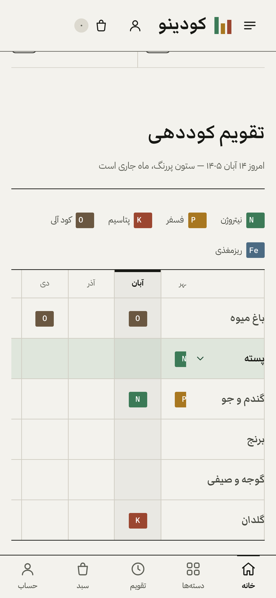

# کودینو (Kudino)

قالب وردپرس فروشگاه تخصصی کود، به همراه سیستم طراحی **Field Almanac**.


| موبایل | تقویم کوددهی در موبایل |
| --- | --- |
|  |  |

اسکرین‌شات کامل صفحه اصلی: [`screenshots/home-desktop.png`](screenshots/home-desktop.png)

## زبان طراحی

سایت‌های رقیب (باسلام، دیجی‌کالا، کودمال، تایمکس) یا مارکت‌پلیس شلوغ‌اند یا قالب آماده‌ی فروشگاهی. کودینو باید شبیه یک **مرجع کشاورزی قابل اعتماد** باشد:

- **کاغذ و جوهر**، با یک سبز مزرعه به‌عنوان تنها رنگ برند. رنگ‌های N، P و K فقط داده نشان می‌دهند و تزئینی نیستند.
- **تایپوگرافی:** Markazi Text برای تیترها، IBM Plex Sans Arabic برای رابط و IBM Plex Mono برای آنالیز کود (مثل `20-20-20`). هر سه فونت داخل قالب میزبانی می‌شوند.
- **خط به جای کارت:** برای جدا کردن بخش‌ها از خط‌کشی، جدول و فهرست استفاده شده، نه کارت و سایه.
- **سه راه ورود:** بر اساس محصول (تقویم کوددهی)، بر اساس نوع کود (فهرست قفسه‌ها) و بر اساس علامت کمبود روی برگ (جدول عناصر).

سیستم طراحی کامل (توکن‌ها، تایپوگرافی، ۱۲ کامپوننت با پیش‌نمایش زنده، لوگو و راهنما) در Claude Design منتشر شده و منبعش در [`design-system/`](design-system) است.

## ساختار

```
kudino/                  قالب وردپرس
  assets/css/tokens.css  توکن‌ها (منبع اصلی)
  assets/css/main.css    کامپوننت‌ها و چیدمان
  assets/css/woocommerce.css
  assets/js/main.js      بدون وابستگی؛ همه‌چیز بدون JS هم کار می‌کند
  assets/fonts/          Markazi Text, IBM Plex Sans Arabic, IBM Plex Mono (OFL)
  inc/                   helpers، داده‌ها، customizer، ووکامرس
  front-page.php         صفحه اصلی
  woocommerce/           قالب آیتم محصول در قفسه
design-system/
  build.py               ساخت فایل‌های سیستم طراحی از روی قالب
  project/               فایل‌های منتشرشده در Claude Design
screenshots/
```

## نصب

۱. پوشه `kudino` را در `wp-content/themes/` کپی و از «نمایش ← پوسته‌ها» فعالش کنید.
۲. (اختیاری) ووکامرس را نصب کنید. دسته‌های محصول با این نامک‌ها به فهرست قفسه‌ها وصل می‌شوند: `chemical`، `organic`، `bio`، `liquid`، `micro`، `houseplant`.
۳. در صفحه ویرایش هر محصول، فیلد «آنالیز NPK» (مثلاً `20-20-20`) و «وزن بسته» را پر کنید.
۴. تلفن، ایمیل، آدرس و متن هیرو را از «سفارشی‌سازی ← تنظیمات کودینو» تغییر دهید.

تا وقتی محصول یا نوشته‌ای ثبت نشده، قالب محتوای نمونه نشان می‌دهد. همه داده‌ها (دسته‌ها، عناصر، تقویم محصولات، محصول هیرو) از طریق فیلترها قابل تغییرند: `kudino_categories`، `kudino_elements`، `kudino_crop_guides`، `kudino_featured_label`، `kudino_demo_products`.

تاریخ‌ها شمسی‌اند (تبدیل داخلی، بدون افزونه). نوار بالای سایت «کار این ماه» را بر اساس ماه جاری نشان می‌دهد.

## به‌روزرسانی سیستم طراحی

اول قالب را تغییر دهید، بعد سیستم طراحی را از روی صفحه رندرشده دوباره بسازید:

```bash
python3 design-system/build.py http://localhost:8080/
```
